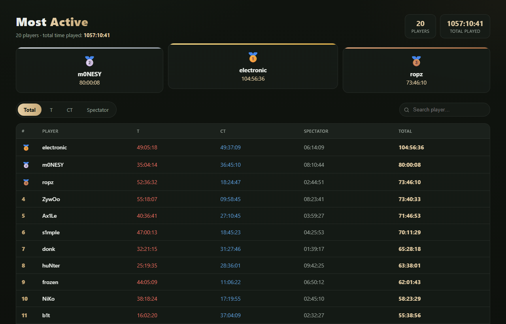

# MostActive — Web rank board

A standalone PHP page that shows the MostActive rank (time played) from the same database the CS2
plugin writes. No framework, no build step. Live search, sortable tabs (Total / T / CT / Spectator),
top-3 podium, pagination (max 25/page).



## Requirements
- PHP **8.0+** with PDO.
- One PDO driver enabled in `php.ini`:
  - **MySQL** → `extension=pdo_mysql`
  - **SQLite** → `extension=pdo_sqlite`
- A web server (Apache / nginx + php-fpm) serving this `web/` folder. The only entry point is
  `index.php`.

## Files
| File | Purpose |
|---|---|
| `index.php` | The page + a JSON endpoint (`?api=1`) used by live search. |
| `Db.php` | PDO wrapper (MySQL + SQLite). |
| `config.php` | Default config — edit here, or override in `config.local.php`. |
| `config.local.php` | Optional local override (git-ignored); it is merged over `config.php`. |

## Configure
Edit `config.php` (or create `config.local.php` returning an array that overrides only what you need).

```php
return [
    'db_type'      => 'mysql',   // 'mysql' or 'sqlite' — MUST match the plugin's Database.Type
    'table_prefix' => 'ma_',     // MUST match the plugin's Database.TablePrefix (table = <prefix>players)

    // used when db_type = mysql
    'mysql' => [
        'host'     => '127.0.0.1',
        'port'     => 3306,
        'database' => 'mostactive',
        'user'     => 'paneluser',
        'password' => 'secret',
        'charset'  => 'utf8mb4',
    ],

    // used when db_type = sqlite — absolute path to the plugin's mostactive.db
    'sqlite_file'  => '/home/cs2/game/csgo/addons/counterstrikesharp/plugins/MostActive/mostactive.db',

    'site_title'   => 'Most Active — Rank',
    'per_page'     => 25,          // rows per page (hard-capped at 25)
    'time_format'  => 'HH:mm:ss',  // match the plugin's TimeFormat (tokens: HH/mm/ss, H/m/s, D=days)
];
```

### MySQL (recommended for a public site)
1. In the plugin's `MostActive.json`, set `Database.Type = "mysql"` and the same MySQL server/db the
   web will use. The plugin creates the `<prefix>players` table on load.
2. In `config.php` set `db_type = 'mysql'`, the same `table_prefix`, and the MySQL credentials.
   A read-only MySQL user is enough for the web.

### SQLite (single box, web + game server on the same machine)
1. Plugin: `Database.Type = "sqlite"` → it writes `mostactive.db` inside the plugin folder.
2. Web: `db_type = 'sqlite'` and `sqlite_file` = the **absolute path** to that `mostactive.db`.
3. The PHP process (php-fpm/apache user) must have **read** access to the file and its folder.

## Install
1. Upload the `web/` folder to your host.
2. Set the config as above (prefer `config.local.php` so updates don't overwrite your settings).
3. Point a vhost / subfolder at it and open `index.php`.
4. Verify: the page shows players and total time. A red "Database error" box means the driver isn't
   enabled or the credentials / sqlite path are wrong.

## Notes
- `config.local.php` is git-ignored — safe place for real credentials.
- The page reads only; it never writes. All data comes from the plugin.
- Local test: `php -S 127.0.0.1:8099` from inside `web/` (ensure pdo_mysql/pdo_sqlite are enabled).
